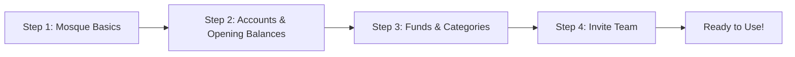

# Mashjid Hisab: UI & Workflow Simplification Guide

> **Core Principle:** An admin, treasurer, or staff member must complete any daily task in under 10 seconds without doubt, hesitation, or accounting jargon—without removing any financial features or compromising ledger integrity.

---

## 1. Current vs. Target Metrics

### A. Sidebar Navigation Items by Role
Currently, the sidebar renders a flat, unorganized list of up to 18 navigation links.

| Role | Current Count | Target Count | Target Structure & Sections |
|---|:---:|:---:|---|
| **Admin** (`MOSQUE_ADMIN`) | **18 items** (flat list) | **5 core areas** (Grouped) | • **Home** (`/dashboard`)<br>• **Approvals** (`/approvals` with live badge)<br>• **DAILY WORK**: Donations, Expenses, Transfers, Box Counting<br>• **PEOPLE**: Members & Families, Chanda & Pledges, Campaigns<br>• **RECORDS**: All Transactions, Reports, Audit Logs<br>• **SETUP** (Collapsed accordion): Accounts, Funds, Categories, Settings |
| **Treasurer** (`TREASURER`) | **16 items** (flat list) | **5 core areas** (Grouped) | Same as Admin, with Audit Logs and Mosque Settings omitted. |
| **Committee** (`COMMITTEE_MEMBER`) | **16 items** (flat list) | **4 read-only areas** | • **Home** (`/dashboard` overview)<br>• **RECORDS**: All Transactions (Ledger), Reports<br>• **ACTIVITIES**: Box Counting (read-only count history)<br>• **PEOPLE**: Members & Families (read-only), Campaigns<br>• **My Giving** (`/me`)<br>*(Financial write actions, Approvals queue, and Setup hidden)* |
| **Staff** (`STAFF`) | **9 items** (flat list) | **5 focused items** | • **Staff Home** (`/dashboard` with quick actions + pending log)<br>• **Record Donation**<br>• **Record Expense**<br>• **Box Counting** (start count & view my counts)<br>• **My Giving**<br>*(Pledges, Campaigns, Categories, and Families hidden to avoid 403 errors and confusion)* |
| **Member** (`MEMBER`) | **5 items** (flat list) | **3 items** | • **My Giving** (Default home landing `/me`)<br>• **Pledges**<br>• **Campaigns**<br>*(Treasurer Dashboard and admin sections hidden; direct access redirects to `/me`)* |

---

### B. Form Fields (Visible Immediately)

| Action | Current Visible Fields | Target Visible Fields | Fields Moved Behind "More Details" / Collapsible |
|---|:---:|:---:|---|
| **Donation** | **11 fields**<br>(Amount, Date, Account, Fund, Category, Source, Donor Name, Phone, Email, Anon checkbox, Notes) | **2 fields** (Box/Jummah)<br>or **3 fields** (Named donor)<br>• Amount (৳)<br>• Category chip<br>• Donor (inline autocomplete; shown only for named categories) | • Date (defaults today)<br>• Depository Account (auto-derived: last-used or oldest active CASH)<br>• Target Fund (auto-derived from Category)<br>• Collection Source (defaults Member / Box)<br>• Public Anonymous toggle<br>• Notes |
| **Expense** | **9 fields**<br>(Amount, Date, Account, Fund, Category, Payee, Voucher #, Receipt upload [required], Notes) | **3 fields**<br>• Amount (৳)<br>• Category chip<br>• Payee / Vendor | • Receipt upload (required above mosque threshold ৳X; optional below)<br>• Disbursed Account (defaults Cash / Bank)<br>• Drawn Fund (auto-derived from Category)<br>• Date (defaults today)<br>• Voucher / Memo #<br>• Notes |
| **Box Counting** | **7 fields** (Start) +<br>**4 fields** (Verify) | **2 fields** (Count) +<br>**1 field** (Independent verify) | • Count: Occasion chip (Default: Jummah), Amount (৳)<br>• Verify: Verifier enters their independent count. Match $\rightarrow$ instant post; mismatch $\rightarrow$ discrepancy flagged with both numbers. |
| **Transfer** | **9 fields**<br>(Amount, Date, From Acc, To Acc, From Fund, Fund Transfer toggle, To Fund, Reason, Notes) | **3 fields**<br>• Amount (৳)<br>• From Account<br>• To Account | • Fund allocation (auto-derived if General Fund has balance; 1-tap select if insufficient)<br>• Date (defaults today)<br>• Reference notes<br>• Inter-fund reallocation (Admin only, requires reason) |

---

### C. Taps to Record a Donation

```mermaid
flowchart TD
    subgraph Current Flow: 8 to 11 Taps
        C1["1. Tap 'Donations'"] --> C2["2. Tap '+ Record Donation'"]
        C2 --> C3["3. Tap Amount & Type"]
        C3 --> C4["4. Tap Account Dropdown"]
        C4 --> C5["5. Select Account"]
        C5 --> C6["6. Tap Fund Dropdown"]
        C6 --> C7["7. Select Fund"]
        C7 --> C8["8. Tap Category Dropdown"]
        C8 --> C9["9. Select Category"]
        C9 --> C10["10. Tap 'Post Donation'"]
    end

    subgraph Target Flow: 3 to 4 Taps in Under 5 Seconds
        T1["1. Tap [+ Record Donation]"] --> T2["2. Type Amount (autofocused keypad)"]
        T2 --> T3["3. Tap Category Chip (e.g., Jummah / General)"]
        T3 --> T4["4. Tap [Save] (or [Save & Add Another])"]
    end
```



---

## 2. Simplified Core Flows

### 2.1 Quick-Add Donation (2 to 3 Fields)
* **Default Display:** Mobile bottom sheet or desktop clean dialog.
* **Fields:**
  1. `Amount (৳)`: Numeric keypad opens automatically on mobile. Quick-amount suggestion chips (`৳100`, `৳500`, `৳1,000`, `৳5,000`).
  2. `Category`: Horizontal scrollable chip selector with most frequent income categories (`[Jummah Box]`, `[General Sadaqah]`, `[Zakat]`, `[Construction]`).
  3. `Donor` (Conditional Inline Field):
     * **Hidden** for box/anonymous collections (`Jummah Box`, `Cash Box`, `General Box`).
     * **Visible Inline (Optional)** with instant autocomplete search for named categories (`Monthly Chanda`, `Zakat`, `Individual Sadaqah`, `Pledge`). Autocomplete searches members and previous walk-in donors with inline `+ Add new donor`.
* **Smart Defaults & Transparency:**
  * Displays derived destination summary badge: *"Depositing into Cash Safe (General Fund)"*.
* **Smart Actions:**
  * `[Save]` (Posts immediately for Admin/Treasurer; saves as Pending for Staff).
  * `[Save & Add Another]` (Immediately resets amount and keeps focus on keypad for fast collection queues).
* **Behind "More details" (`<details>` accordion):**
  * Date (defaults today).
  * Account (shows derived account with dropdown to change).
  * Fund (shows derived Fund name).
  * Public anonymous toggle.
  * Notes.

### 2.2 Category Flagging for Donor Field
To decide whether the donor field is shown inline or hidden:
* **Database Model (Cleanest):** Add `allowsDonor Boolean @default(true)` on `Category` schema.
* **Smart Heuristic (Zero Migration / Immediate):**
  * Check if Category name matches `/box|jummah|cash box|দান বাক্স|কালেকশন/i` or Category has `source: CASH_BOX`:
    * If match $\rightarrow$ Hide donor field by default.
    * If no match $\rightarrow$ Show optional inline donor search field.

### 2.3 Quick-Add Expense (3-Field Default) & Receipt Policy
* **Default Display:** Clean dialog / bottom sheet.
* **Fields:**
  1. `Amount (৳)`: Autofocused numeric input.
  2. `Category`: Chip selector (`[Electric Bill]`, `[Imam Honorarium]`, `[Cleaner]`, `[Repairs]`).
  3. `Payee / Vendor`: Auto-suggest text input (e.g., "DESCO", "Maulana Abdur Rahman", "Hardware Store").
* **Receipt Policy (Mosque Setting `receiptRequiredThreshold`):**
  * Configurable in Mosque Settings: *"Receipt required above ৳X"* (e.g., ৳1,000 or ৳2,000).
  * **Expenses $\le$ ৳X:** Receipt attachment is completely optional. Submit button is enabled immediately.
  * **Expenses $>$ ৳X:** Receipt photo attachment is required before submission.
  * **Missing Receipts List:** A dedicated filter/tab on Expenses and Approvals: *"Expenses missing receipt ($N$)"* to allow attaching receipts later.
* **Behind "More details":**
  * Disbursing Account (defaults to primary Bank or Cash account).
  * Voucher / Memo Number.
  * Date (defaults today).
  * Notes / Description.

### 2.4 Approvals Hub (Dedicated Route `/approvals`)
* **Live Badge in Sidebar:** Always shows exact count of pending items (e.g., `Approvals (3)`).
* **Single-Screen Review:**
  * Clean card-based queue showing: Type, Amount, Initiator, Category, Payee, and Date.
* **5-Second Delayed Commit (Safe Approval):**
  * Clicking `[Approve]` does not immediately send a network post that requires reversal if misclicked.
  * The card immediately turns into a 5-second countdown state: *"Approved. Committing in 5s... [Undo]"*.
  * The actual API commit executes once the 5-second timer expires.
* **Bulk Approval:**
  * Applies strictly to **Donations only** (never expenses).
  * Action bar shows aggregated sum: *"Approve 4 donations (Total: ৳12,500)"*.
  * High-risk items and expenses are excluded from bulk actions and require individual review.
* **Rejections:** Single tap `[Reject]` opens a prompt requiring a rejection reason.

### 2.5 Box Counting: Blind Double-Entry Verification
* **Step 1 — Counting (Staff or Committee):**
  * Occasion selector: Chips for `[Friday Jummah]`, `[Taraweeh]`, `[Eid Collection]`, `[General Box]`.
  * Total Counted Amount: Entered by counter.
  * Saves session as `OPEN`.
* **Step 2 — Verification (Treasurer or Admin):**
  * Verifier opens verification modal. The counter's amount is **not pre-filled**.
  * Verifier enters their independent count: *"Enter verified count (৳)"*.
  * **Match:** Instant green confirmation: *"Counts match (৳45,200). Posted to ledger."*
  * **Mismatch:** System flags discrepancy with both figures: *"Count mismatch! Counter: ৳45,200, Verifier: ৳45,000 (Difference: ৳200). Please recount or resolve."* Both values and notes are stored.

### 2.6 Physical Transfers: Code Reality & Derive-vs-Ask
* **Code Verification (`transfer.service.ts` & `transfer.validation.ts`):**
  * In the codebase, every transfer creates two legs (`FROM` and `TO`). Both legs require `fundId` (or `fromFundId` and `toFundId`).
  * `availableFundBalance` is checked against `fromFundId`.
  * For account-to-account transfers (e.g., Cash Safe $\rightarrow$ Bank A/C), `fromFundId === toFundId`.
* **Derive-vs-Ask Strategy:**
  * **Derive (Default):** Pre-select `General Fund`. If `availableFundBalance(General) >= amount`, derive automatically and show: *"Fund: General Fund (৳40,000 available)"*.
  * **Ask (Smart Fallback):** If `General Fund` has insufficient balance, or if user taps `[Change Fund]`, display a single-tap dropdown showing available balance per fund (e.g., *Construction Fund: ৳1,20,000 available*).
* **Inter-Fund Reallocations:** Relabeled to *"Reallocate between Funds"*, restricted to Admin only, and requires an administrative justification reason.

### 2.7 Chanda Collection Flow
* Accessible from `PEOPLE` $\rightarrow$ `Chanda & Dues`.
* Grid view: Members $\times$ Months.
* **1-Tap Mark Paid:** Staff/Treasurer taps an unpaid month cell $\rightarrow$ Dialog pre-filled with member's plan amount (e.g., ৳500) $\rightarrow$ Tap `[Confirm ৳500 Paid]` $\rightarrow$ Automatically posts donation to Chanda category & General Fund, updates Due record to `PAID`, and issues receipt.

---

## 3. Account & Fund Derivation Specification

### 3.1 Account Derivation Hierarchy
When `accountId` is omitted from an incoming request:
1. **User's Last-Used Account:** Check the user's most recent active donation/expense in this mosque during the current session.
2. **Oldest Active Cash Account:** Find `Account` where `mosqueId = mosqueId`, `type = 'CASH'`, and `isArchived = false`, ordered by `createdAt: 'asc'`.
3. **Error Boundary:** If no active account exists, reject with a clear human error:
   ```json
   {
     "code": "NO_ACTIVE_ACCOUNT",
     "message": "No active cash account found. Please create an account in Setup first."
   }
   ```

### 3.2 Fund Derivation Hierarchy
When `fundId` is omitted from an incoming request:
1. **Category Linked Fund:** If `category.fundId` is set, use it.
2. **Active General Fund:** If `category.fundId` is null, find `Fund` where `mosqueId = mosqueId`, `type = 'GENERAL'`, and `isArchived = false`.
3. **Oldest Active Fund:** Fallback to the earliest active fund in the mosque.
4. **Error Boundary:** If no active fund exists, reject with:
   ```json
   {
     "code": "NO_ACTIVE_FUND",
     "message": "No active fund found. Please create a fund in Setup first."
   }
   ```

### 3.3 Visual & API Feedback
* **Form UI:** Displays dynamic preview pill before posting: *"Posting to Cash Safe (General Fund)"*.
* **API Response:** The creation endpoint returns the fully resolved entities in the response body:
  ```json
  {
    "id": "cuid...",
    "amount": "50000",
    "account": { "id": "acc_1", "name": "Cash Safe", "type": "CASH" },
    "fund": { "id": "fund_1", "name": "General Fund", "type": "GENERAL" }
  }
  ```

---

## 4. Role Matrix & Box-Counting Alignment

### 4.1 Navigation Matrix (All 5 Roles)

| Nav Section / Route | Admin | Treasurer | Committee | Staff | Member |
|---|:---:|:---:|:---:|:---:|:---:|
| **Dashboard** (`/dashboard`) | Full Admin View | Financial View | Read-Only Overview | Staff Home (Quick add + My logs) | Redirects to `/me` |
| **Approvals** (`/approvals`) | Full Review | Full Review | Hidden | Hidden | Hidden |
| **Donations** (`/donations`) | Full Access | Full Access | Read-Only | Quick-Add (Pending) | Hidden |
| **Expenses** (`/expenses`) | Full Access | Full Access | Read-Only | Quick-Add (Pending) | Hidden |
| **Transfers** (`/transfers`) | Full Access | Full Access | Hidden | Hidden | Hidden |
| **Box Counting** (`/collections`) | Start & Verify | Start & Verify | View History (Read-only) | Start Count & View History | Hidden |
| **Chanda & Dues** (`/chanda`) | Full Access | Full Access | Read-Only | Mark Paid | Hidden |
| **Members & Families** | Full Access | Full Access | Read-Only | Read-Only | Hidden |
| **Reports** (`/reports`) | Full Access | Full Access | Full Access | Hidden | Hidden |
| **My Giving** (`/me`) | Full Access | Full Access | Full Access | Full Access | Default Home |
| **Audit Logs** (`/audit-logs`) | Full Access | Hidden | Hidden | Hidden | Hidden |
| **Setup** (Accounts/Funds/Cats) | Full Access | Full Access | Hidden | Hidden | Hidden |

### 4.2 Resolving Box-Counting Roles Mismatch (`docs/API.md`)
* **Problem:** In backend `collection.routes.ts`, `GET /collections` and `GET /collections/:id` are gated by `OVERSIGHT_ROLES` (`ADMIN`, `TREASURER`, `COMMITTEE`). However, `POST /collections` allows `STAFF` (`COLLECTION_OPERATOR_ROLES`). This means Staff who record counts receive a 403 error when trying to view the counting history. In frontend `sidebar.tsx`, Counting Sessions was gated by `COLLECTION_OPERATOR_ROLES`, hiding it from Committee members who have read permissions.
* **Resolution:**
  1. **Backend:** Update `GET /collections` and `GET /collections/:id` to allow `COLLECTION_OPERATOR_ROLES` in addition to `OVERSIGHT_ROLES`. Staff can view sessions; Committee can view history.
  2. **Frontend:** Update `sidebar.tsx` so Counting Sessions is visible to both Staff and Committee.

---

## 5. First-Time Setup Wizard (4 Steps)

> **Dependency:** The Setup Wizard (T07B) depends on **T02 (Unallocated Money)** to enforce the opening balance fund allocation invariant.



### Step 1: Mosque Basics
* Mosque Name (e.g., "Baitul Aman Jame Masjid").
* Location / Address.
* Fiscal Year Start (Default: July / Ashar).
* Timezone (Default: `Asia/Dhaka`).

### Step 2: Primary Accounts & Opening Balance Allocation
* Auto-creates **"Cash Safe / Cash in Hand"** (`type: CASH`).
* Optional Bank Account / bKash wallet.
* **Opening Balance Invariant Prompt (T02 integration):**
  * If an opening balance is entered (e.g., ৳50,000 in Cash Safe):
  * Prompt: *"Which fund does this opening balance belong to?"*
  * Default: `General Fund (৳50,000)`.
  * Option: `[Split across funds]` (e.g., ৳30,000 General Fund, ৳20,000 Construction Fund).
  * Guarantees $\sum \text{Accounts} == \sum \text{Funds}$ from second zero!

### Step 3: Default Funds & Categories Seed
* Pre-populates standard template:
  * **Funds:** `General Fund`, `Zakat Fund`, `Development & Construction`.
  * **Income Categories:** `Friday Jummah Collection` (General), `General Sadaqah` (General), `Zakat Collection` (Zakat), `Member Chanda` (General).
  * **Expense Categories:** `Utilities`, `Imam & Staff Honorarium`, `Cleaning & Maintenance`, `Zakat Distribution`.

### Step 4: Invite Your Team
* Invite Treasurer (Phone/Email).
* Invite Staff/Imam.
* Generate WhatsApp Invite Link for Committee.

---

## 6. Safety, Confirmations & Accessibility Rules

### 6.1 Large-Amount Confirmation Modal
* Any donation, expense, or transfer $\ge$ **৳50,000** (configurable threshold) triggers a confirmation modal.
* **Word Representation:** Displays the exact amount spelled out in Bengali and English words to prevent extra-zero keystroke errors:
  > *"Confirm large transaction: ৳50,000 (Fifty Thousand Taka / পঞ্চাশ হাজার টাকা)"*

### 6.2 Monthly Report Fast Action
* Prominent, 1-tap **[Download Monthly Report (PDF / Bangla)]** button placed directly on the Dashboard and Reports header.

### 6.3 Older-User Accessibility Rules
Mosque committee members and treasurers are frequently seniors using smartphones:
1. **Font Size:** Minimum 16px font size on all input fields (avoids mobile viewport zoom bugs).
2. **Touch Targets:** Minimum 48px $\times$ 48px touch targets for buttons, category chips, and tabs.
3. **Contrast:** High-contrast text (minimum 4.5:1 ratio, 7:1 for financial amounts). Clear emerald on light background; crisp white/emerald on dark mode.
4. **Numerals:** Financial figures displayed in large bold text (`text-xl` or `text-2xl`), with optional Bangla numerals (`১২,৩৪৫ ৳`).
5. **No Double-Tap Failures:** Buttons disabled immediately upon submit with haptic/visual feedback.

---

## 7. Progressive Disclosure Matrix

| Domain | Always Visible on Primary Screen | Behind "More Details" / Collapsible | Behind "Advanced" (Admin Only) |
|---|---|---|---|
| **Dashboard** | • Slim greeting banner<br>• Action row (`[Record donation]`, `[Record expense]`, `[Count box]`, `[Transfer]`)<br>• Attention strip (Pending items)<br>• 3 KPI Cards (Total Balance, Income, Spending)<br>• 1-tap Monthly Report Download | • Breakdown of Cash vs. Bank<br>• Fund list (empty funds hidden behind "Show empty funds") | • Unallocated balance fix trigger<br>• Closed accounting period lock status |
| **Donation** | • Amount (৳)<br>• Category chip<br>• Donor (inline autocomplete; only for named categories) | • Date<br>• Depository Account<br>• Target Fund<br>• Anonymous toggle<br>• Notes | • Backdated entries (>30 days)<br>• Direct linked Campaign / Pledge override |
| **Expense** | • Amount (৳)<br>• Category chip<br>• Payee name<br>• Receipt upload (only if $>$ ৳X) | • Receipt upload (if $\le$ ৳X)<br>• Disbursing Account<br>• Drawn Fund<br>• Date<br>• Voucher / Memo number<br>• Notes | • Split expense across multiple funds<br>• Tax / withholding details |
| **Transfers** | • Amount (৳)<br>• From Account<br>• To Account | • Transfer date<br>• Reference notes<br>• Target fund override (if General has insufficient balance) | • Inter-fund reallocation<br>• Administrative justification record |
| **Box Counting**| • Occasion chip (Jummah)<br>• Counted amount (৳) | • Denomination counter helper (৳1000, ৳500 count breakdown)<br>• Count notes | • Discrepancy override log |
| **Members** | • Name<br>• Phone<br>• Role | • Address<br>• Family household link<br>• Monthly Chanda amount | • Membership status suspension<br>• Permissions override |
